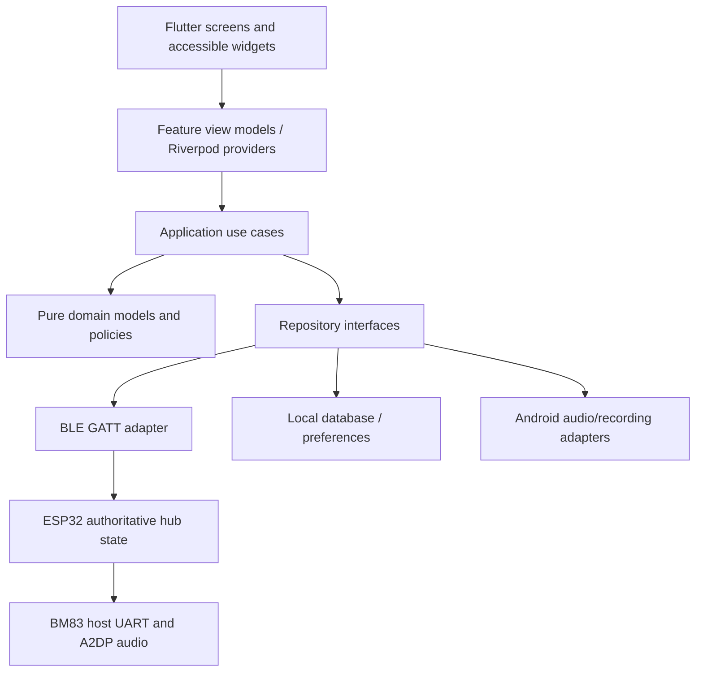
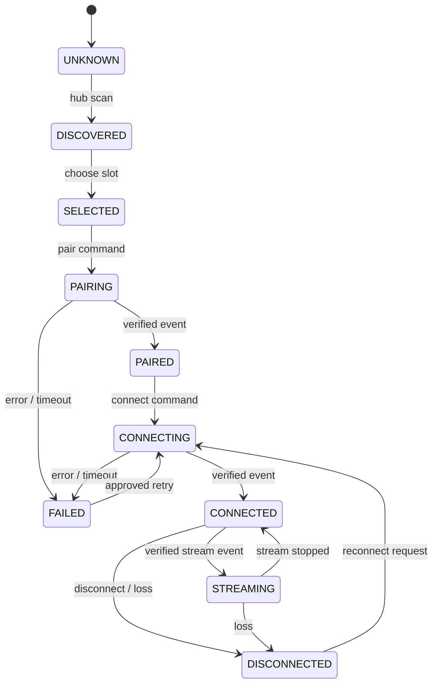

# SDD — Software Design Document

> **Project:** BT SHARE — Android Flutter App  
> **Version:** 0.1.0 | **Created:** 2026-10-28 | **Status:** Draft for review  
> **Document owner:** Flutter mobile team | **Approval:** Pending product/Flutter/embedded review  
> **Evidence boundary:** Based on repository `main` reviewed 2026-10-28; this is a proposed, executable specification, **not proof of working code, firmware, hardware, or tests**.

## 1. Design overview
**Status:** Reference architecture proposed for implementation; package and layer choices are not yet team-approved. Product consists of a hub control vertical slice and locally functioning audio-tool vertical slices with shared settings, storage, permissions, playback and diagnostics.



## 2. Proposed source layout
```text
lib/
  app/                   # bootstrap, app shell, router, themes, localization
  core/
    errors/              # typed failures, mapping, no raw vendor errors in UI
    permissions/         # Bluetooth/mic/media UX + permission service
    audio/               # playback focus, session and audio-source contracts
    persistence/         # local DB, migrations, retention, export
    logging/             # redacted diagnostics
  features/
    connect/             # hub + receivers + scan + recovery + capability gates
      domain/ application/ data/ presentation/
    player/              # local files, queue, playback
      domain/ application/ data/ presentation/
    sound_lab/            # EQ, visualizer, analysis
      domain/ application/ data/ presentation/
    ambient/             # licensed layers, timer, favorites
      domain/ application/ data/ presentation/
    recorder/             # mic capture and notes
      domain/ application/ data/ presentation/
    practice/             # tuner, metronome, later rhythm/practice room
      domain/ application/ data/ presentation/
    my_sound/             # profiles, diagnostics, dashboard, privacy
      domain/ application/ data/ presentation/
  l10n/                  # reviewed English/Tamil ARB resources
```
**Dependency rule:** presentation → application → domain; data implements domain-defined ports. No direct BLE package usage in widgets. Prefer small, testable feature vertical slices rather than large shared god-services.

## 3. Core domain models
| Entity/value | Fields | Invariants |
|---|---|---|
| `Hub` | `hubId`, `protocolVersion`, `capabilities`, `lastSeenAt`, `connectionState` | Treat offline snapshots as stale |
| `Receiver` | opaque `receiverId`, `name`, `alias?`, `slot?`, `pairingState`, `connectionState`, `streamingState`, `lastEventAt?` | Paired ≠ connected ≠ streaming |
| `HubOperation` | `requestId`, `action`, `targetId?`, `issuedAt`, `status`, `error?` | Response corresponds to request; timeout is explicit |
| `AudioSource` | `sourceType`, local media URI, microphone/generator as supported | External AUX not available to phone by BLE |
| `SoundProfile` | id, display name, bands/balance, schemaVersion, route scope | Only apply to supported audio path |
| `Recording` | id, consent context, persistent URI, codec, duration, timestamps | Local ownership; no silent capture |
| `DiagnosticEvent` | id, category, timestamp, hub ID pseudonym?, outcome, redacted fields | No raw secrets or audio payloads |

## 4. Receiver state model

When the hub BLE link is lost, the app marks receiver states **unknown/stale** (do not synthesize individual receiver disconnect events). Re-query a snapshot on reconnect.

## 5. Primary use-case contracts
- `ConnectHub(hubRef)` → request permission → BLE connect → negotiate protocol → subscribe to events → snapshot; typed failures `PermissionDenied`, `BluetoothOff`, `Timeout`, `IncompatibleProtocol`.
- `ScanReceivers()` → verify hub ready/capability → request scan → collect bounded updates → persist last scan metadata only if allowed.
- `SelectReceiver(receiverId, slot)` → unique nonempty slot, ≤2 current prototype; if disconnected command fails, do not update authoritative assignment.
- `Pair/Connect/Disconnect/Reconnect(receiverId)` → validated command → pending UI → ack then authoritative event/snapshot; retry only safe operations.
- `PlayLocalTrack(uri)` → verify URI access / codec → manage Android audio focus → playback state stream; independent of hardware hub.
- `ApplyProfile(profileId, route)` → validate data and route capability → apply to owned stream; explain unavailability otherwise.
- `StartRecording()` → user gesture and microphone consent → obtain permissions → start capture; partial-file cleanup on interruption.

## 6. Data and event flows
**Hub update:** GATT notification (firmware contract) → `BleMessageDecoder` → sequence/version validation → `HubStateReducer` → reactive view model → widgets; persist only minimized diagnostics/aliases as permitted.

**Standalone playback:** Android document picker → user-granted URI → local player repository → playback engine + audio-focus coordinator → optional supported EQ/visualizer → device output; publish progress to UI. External AUX and phone playback remain separate.

**Offline data:** repositories use transactional storage, explicit migrations, file URI grants and retention policy. Avoid duplicating all receiver telemetry in SQLite by default.

## 7. State and error strategies
Use discriminated UI states `idle/loading/success/empty/error/unsupported` with structured error IDs and recoverability metadata. Handle race conditions: stale response after reconnect; double tapping Connect; scan running during hub disconnect; notification arriving after screen exit; lifecycle pause/resume. Cancel subscriptions and invalidate old session IDs on teardown.

## 8. Capability-driven UI
`HubCapabilities` comes from the firmware handshake and is **not invented** on the phone. Example candidate flags: `can_scan`, `max_active_receivers`, `can_set_independent_volume`, `can_report_streaming`, `can_update_firmware`. Absence of capability means unavailable, not default true. UI should show reasons.

## 9. Design for testability
Repository fakes simulate BLE timeouts, out-of-order notifications, unknown receiver IDs, denied permission and firmware error. Deterministic clocks for timeout tests; audio abstractions with fake media session, URI and microphone access; temporary local DB for migration tests; platform integration tests on devices.

## 10. Design decisions to formalize
See [ADR](11_ADR_Architecture_Decision_Records.md) for accepted historical boundaries vs proposed library/persistence/navigation decisions. Cross-check [API Spec](09_API_Specification.md) and [DB Design](10_DB_Design.md) before implementation.

## Source references and document control

- [overview](https://github.com/X10THINK/BT-SHARE/blob/main/README.md)
- [status](https://github.com/X10THINK/BT-SHARE/blob/main/PROJECT_STATUS.md)
- [requirements](https://github.com/X10THINK/BT-SHARE/blob/main/REQUIREMENTS.md)
- [decisions](https://github.com/X10THINK/BT-SHARE/blob/main/DECISIONS.md)
- [brd](https://github.com/X10THINK/BT-SHARE/blob/main/Basic%20Documents/MD/BT_SHARE_BRD.md)
- [plan](https://github.com/X10THINK/BT-SHARE/blob/main/Basic%20Documents/MD/BT_SHARE_Execution_Plan.md)
- [catalogue](https://github.com/X10THINK/BT-SHARE/blob/main/docs/mobile-app/FEATURE_CATALOGUE.md)
- [x25](https://github.com/X10THINK/BT-SHARE/blob/main/docs/mobile-app/FEATURE_EXPANSION_25.md)
- [y17](https://github.com/X10THINK/BT-SHARE/blob/main/docs/mobile-app/FEATURE_EXPANSION_17.md)
- [feasibility](https://github.com/X10THINK/BT-SHARE/blob/main/docs/mobile-app/FEASIBILITY_REGISTER.md)
- [product](https://github.com/X10THINK/BT-SHARE/blob/main/docs/mobile-app/PRODUCT_SCOPE.md)

**Change control:** Before implementation, confirm current source commit, product scope, prototype firmware capabilities, Android device matrix, ownership and acceptance criteria. Revisions must log approver, date and affected requirement IDs. The existing repository baseline remains authoritative for recorded historical decisions; this new pack does not silently supersede it.
