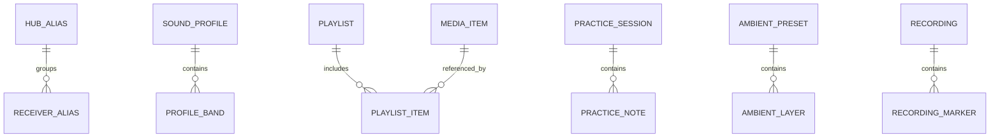

# DB Design — Android Local Storage (Proposed)

> **Project:** BT SHARE — Android Flutter App  
> **Version:** 0.1.0 | **Created:** 2026-10-28 | **Status:** Draft for review  
> **Document owner:** Flutter data lead | **Approval:** Pending product/Flutter/embedded review  
> **Evidence boundary:** Based on repository `main` reviewed 2026-10-28; this is a proposed, executable specification, **not proof of working code, firmware, hardware, or tests**.

## 1. Data boundary and persistence decision
No mandatory cloud database or user account is approved for the Android client. **Proposed** implementation: local SQLite with a typed ORM (Drift or equivalent) for structured records; secure platform storage only if later secrets are unavoidable; platform document URIs for user audio. This design is **not yet an approved migration schema**. It must be reviewed against privacy, storage, package, offline and backup requirements.

## 2. Conceptual data model

No permanent hub state/paired device database is assumed: the ESP32 owns actual pairing and connection. Local cache may store user aliases and last-viewed data marked stale.

## 3. Proposed tables
| Table | Primary columns | Key behavior / sensitive details |
|---|---|---|
| `schema_meta` | `schema_version INTEGER`, `migrated_at TEXT` | Migrations versioned, never silently reset |
| `app_setting` | `key TEXT PK`, `json_value TEXT`, `updated_at` | Whitelist validated keys; no secrets |
| `hub_alias` | `hub_ref TEXT PK`, `alias TEXT`, `last_seen_at TEXT?` | Pseudonymous stable ID; avoid raw MAC if possible |
| `receiver_alias` | `hub_ref`, `receiver_ref`, `alias`, `updated_at` | Composite PK; in-app label only; not firmware pairing authority |
| `sound_profile` | `profile_id TEXT PK`, `schema_version INT`, `name`, `route_scope`, `created_at`, `updated_at` | EQ settings source/route applicability explicit |
| `profile_band` | `profile_id`, `band_index`, `center_hz`, `gain_db`, `q?` | Unique profile/band; bounded gain/ranges |
| `media_item` | `media_id TEXT PK`, `uri TEXT`, `title?`, `duration_ms?`, `last_checked_at?` | User-granted content URI; verify access before playback |
| `playlist` | `playlist_id TEXT PK`, `name`, `created_at` | Local, user editable |
| `playlist_item` | `playlist_id`, `position`, `media_id` | Transactional reorder; FK to media |
| `ambient_preset` | `preset_id TEXT PK`, `name`, `sleep_timer_ms?` | Timer/volume bounded |
| `ambient_layer` | `preset_id`, `layer_id`, `volume_gain`, `enabled` | Licensed built-in/local asset references |
| `recording` | `recording_id TEXT PK`, `uri`, `codec`, `duration_ms`, `recorded_at`, `consent_context?` | Actual file may exist outside DB; explicit deletion handling |
| `recording_marker` | `recording_id`, `offset_ms`, `label?` | FK, remove on recording deletion |
| `practice_session` | `session_id TEXT PK`, `started_at`, `ended_at?`, `instrument?`, `goal?` | Local private practice history |
| `practice_note` | `note_id TEXT PK`, `session_id`, `body`, `created_at` | User-generated data, deletion/export required |
| `favorite` | `favorite_id TEXT PK`, `target_type`, `target_id`, `sort_order` | Polymorphic refs validated in app layer |
| `diagnostic_event` | `event_id TEXT PK`, `category`, `event_code`, `occurred_at`, `sanitized_details?`, `expires_at` | Minimized/redacted and capped retention |

**Future-only candidates:** `automation_rule`, `audio_spectrum_session`, `saved_receiver_group`, `ai_assistant_session` — **do not create until feature, consent and retention rules are approved**.

## 4. Logical constraints and indexes
- Enable foreign keys; enforce `CHECK` on positive durations, bounded volume/gain, nonnegative position/marker offset and supported schema versions.
- Unique `receiver_alias(hub_ref, receiver_ref)`; `playlist_item(playlist_id, position)`; `profile_band(profile_id, band_index)`.
- Index histories by `recorded_at/started_at/occurred_at`; diagnostics filtered by expiry.
- Store time in UTC ISO-8601 or integer epoch consistently; convert to local display in UI.
- JSON values must be schema-validated with defined defaults/migration, not arbitrary unchecked blobs.

## 5. Storage ownership and offline rules
- The database contains **user configuration and metadata**, not unapproved stored copies of raw third-party audio.
- Recording files remain local and are exported only through explicit user action; DB holds a URI/reference, not huge BLOBs.
- Media references may become invalid after permission revocation, file deletion or app migration. Reopen via Android picker with actionable UI.
- Bluetooth hub receiver MAC/device identifiers are potentially identifying; prefer firmware-issued opaque IDs and avoid uploading.
- Pairing keys and authoritative connection state are **not** stored/managed by this Flutter database.
- No hidden cloud sync; if introduced later, a separate ADR/PRD/privacy review is mandatory.

## 6. Migration strategy
`v1` is a **proposal**, not a deployed schema. Choose storage technology in ADR before committing migrations. Once released, all changes must be forward-only, checked by transaction tests and include fixtures for at least the previous supported schema. Unknown/corrupt schema yields safe recovery/export guidance; do not silently wipe.

## 7. Privacy, deletion and backup
- User requests clear data → show itemized scope (presets/playlists/recordings/history/aliases) → confirm → delete metadata and application-owned recording files where OS permits → report partial failures.
- Retention: diagnostics use a configurable maximum count/age; exact defaults require privacy approval. Recording retention is user-controlled unless legal/OS requirements apply.
- Backup strategy must define whether Android automatic backup is used, whether recordings are included, and whether device identifiers should be excluded. All require review.
- Any export must sanitize system-only fields and be safe against formula injection on CSV-style export; JSON import validated before transaction.

## 8. Repository API example (abstract, not a selected package)
```dart
abstract interface class SoundProfileRepository {
  Future<List<SoundProfile>> listProfiles();
  Future<SoundProfile> saveValidated(SoundProfile draft);
  Future<void> deleteById(String id);
  Stream<List<SoundProfile>> watchProfiles();
}
```
Implementations must handle cancellation, transaction boundaries and errors as typed failures, not raw SQLite exceptions inside widgets.

## 9. Verification and open decisions
Tests: v1 setup, migration from previous fixture, duplicate alias prevention, invalid EQ bounds, playlist reorder transaction rollback, revoked media URI, low storage, concurrent saves, clear-data deletion and diagnostics expiration. Decide storage library, encryption/backup policy, retention durations, content URI policy and data export shape before schema freeze.

## Source references and document control

- [overview](https://github.com/X10THINK/BT-SHARE/blob/main/README.md)
- [status](https://github.com/X10THINK/BT-SHARE/blob/main/PROJECT_STATUS.md)
- [requirements](https://github.com/X10THINK/BT-SHARE/blob/main/REQUIREMENTS.md)
- [decisions](https://github.com/X10THINK/BT-SHARE/blob/main/DECISIONS.md)
- [brd](https://github.com/X10THINK/BT-SHARE/blob/main/Basic%20Documents/MD/BT_SHARE_BRD.md)
- [plan](https://github.com/X10THINK/BT-SHARE/blob/main/Basic%20Documents/MD/BT_SHARE_Execution_Plan.md)
- [catalogue](https://github.com/X10THINK/BT-SHARE/blob/main/docs/mobile-app/FEATURE_CATALOGUE.md)
- [x25](https://github.com/X10THINK/BT-SHARE/blob/main/docs/mobile-app/FEATURE_EXPANSION_25.md)
- [y17](https://github.com/X10THINK/BT-SHARE/blob/main/docs/mobile-app/FEATURE_EXPANSION_17.md)
- [feasibility](https://github.com/X10THINK/BT-SHARE/blob/main/docs/mobile-app/FEASIBILITY_REGISTER.md)
- [product](https://github.com/X10THINK/BT-SHARE/blob/main/docs/mobile-app/PRODUCT_SCOPE.md)

**Change control:** Before implementation, confirm current source commit, product scope, prototype firmware capabilities, Android device matrix, ownership and acceptance criteria. Revisions must log approver, date and affected requirement IDs. The existing repository baseline remains authoritative for recorded historical decisions; this new pack does not silently supersede it.
