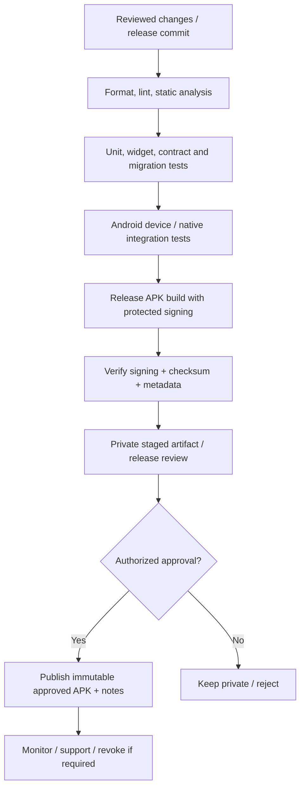

# Deployment Plan — Flutter Android Release and APK Distribution

> **Project:** BT SHARE — Android Flutter App  
> **Version:** 0.1.0 | **Created:** 2026-10-28 | **Status:** Draft for review  
> **Document owner:** Release engineering / Flutter lead | **Approval:** Pending product/Flutter/embedded review  
> **Evidence boundary:** Based on repository `main` reviewed 2026-10-28; this is a proposed, executable specification, **not proof of working code, firmware, hardware, or tests**.

## 1. Target and current status
Flutter Android deployment is **planned only**. Repository `main` does not currently contain Flutter build source or a released APK. The separate **Angular website** documentation proposes an APK download center and secure release admin. This plan covers **mobile artifact delivery and handoff**; website deployment details require a separate website release plan. No real CI signing/hosting platform, package ID, min SDK or release channels have been finalized.

## 2. Environment strategy
| Environment | Purpose | Data/signing | Distribution |
|---|---|---|---|
| Dev | Developer iteration, BLE emulator, tests | Debug signing, mock/test values | Local Android device/emulator |
| QA/Staging | Cross-device feature, firmware and UAT testing | Distinct test configuration; non-production signatures | Controlled tester group |
| Production | Signed, versioned approved artifact | Protected release key and reproducible record | Approved public website release center and/or app store if separately approved |

Never embed backend/admin secrets in the APK. No production backend is needed for the current local-first/ESP32 BLE model. If a website API or cloud feature is later approved, add its threat model and endpoints to a revised separate contract.

## 3. Build prerequisites
- Flutter/Dart/Android toolchain versions locked and reproducible; `pubspec.lock` and checked-in build settings.
- Approved application package name / applicationId, version name/code policy and release channels.
- Min/target SDK chosen from support and legal/policy checks; orientation, icon, language and accessibility validated.
- Approved library licenses, audio sample licenses, privacy notice, permissions and Google Play/device-policy review as applicable.
- Build machine/CI permissions least-privilege; all release signing materials stored only in protected secrets/HSM/service, not repository.
- Release build source commit immutable/tagged, test record linked and dependency vulnerability scan completed.

## 4. Proposed CI/CD workflow

Use versioned staged artifacts. Build metadata must capture commit SHA, Flutter/Gradle/Android toolchain, applicationId, version name/code, build timestamp, supported ABI(s), min SDK, changelog, SHA-256, signing certificate fingerprint and approving actors.

## 5. Verification before publishing
1. Flutter `analyze`, unit, widget, migration and contract tests green; native Android permission/audio lifecycle tests attached.
2. UAT/Accessibility/Privacy approved; no known release-blocking issue.
3. Debug flags/logging/services disabled; API capability flags not overridden to fake firmware support.
4. Check APK format and installability on approved device matrix; inspect requested manifest permissions and exported components.
5. Verify signer identity with Android build tooling, independently compute artifact SHA-256 and compare staged metadata.
6. Ensure no embedded passwords, admin API keys, tokens, raw diagnostic dumps, excluded libraries or unlicensed audio assets.
7. Verify signed artifact has no silent changes after approval; release metadata immutable. Website team validates MIME, magic bytes, size, signer provenance and quarantined upload separately.
8. Download through the **same public flow** users will use; re-check checksum, installation, update/migration, release notes and revoked-version handling.

## 6. Publication handoff to Angular website team
| Field | Required content |
|---|---|
| Application | Approved display name, Android package ID, versionName/versionCode |
| Artifact | Signed APK file, SHA-256, size, ABI and min supported Android |
| Authenticity | Verified signing cert fingerprint, originating reviewed commit/build |
| Release | Channel (stable/beta), publish date, notes, compatibility, known issues |
| Visibility | `draft → staged → approved → published`; only published files visible anonymously |
| Recovery | Revocation / replacement plan and support contact |

Website admin must enforce roles and permissions **server-side**, independently of Angular route guards. Draft documents/APKs should not be indexed or downloadable by guessing a URL. Download analytics, e-commerce and mobile user accounts are not silently included.

## 7. Update, rollback and incident response
- Android normally will not accept arbitrary downgrade to a lower versionCode or differently signed APK; “rollback” generally means republishing a corrected **higher versionCode** with the trusted original signing identity, with migration compatibility review.
- For critical defect: stop future publication, mark affected release revoked/not recommended, retain audit record, publish clear support notice and patched successor; coordinate safe user data migration.
- For signing key compromise: incident response and any platform-specific key rotation process require release/security approval; do not imply old APK can be trivially fixed.
- For ESP32 firmware incompatibility, show protocol mismatch and supported app version guidance; do not silently downgrade a GATT protocol or run unsupported OTA.
- Preserve app-generated recordings and presets through updates unless migration/deletion is explicitly signed off and disclosed.

## 8. Operational acceptance and next actions
Select release owner, signing custody, distribution channel, domain/backend (separate website), device support/versions, package ID, privacy policy, vulnerability scanning, release versioning and incident contact. Implement CI and handoff only after scope/ADR approvals.

**Release is considered complete only when:** approved signed APK, reproducible build evidence, matching hash/signer, passed UAT, installation/upgrade check, accurate release notes, controlled public visibility, revocation capability and a named support/incident owner exist. No release success is claimed by this draft.

## Source references and document control

- [overview](https://github.com/X10THINK/BT-SHARE/blob/main/README.md)
- [status](https://github.com/X10THINK/BT-SHARE/blob/main/PROJECT_STATUS.md)
- [requirements](https://github.com/X10THINK/BT-SHARE/blob/main/REQUIREMENTS.md)
- [decisions](https://github.com/X10THINK/BT-SHARE/blob/main/DECISIONS.md)
- [brd](https://github.com/X10THINK/BT-SHARE/blob/main/Basic%20Documents/MD/BT_SHARE_BRD.md)
- [plan](https://github.com/X10THINK/BT-SHARE/blob/main/Basic%20Documents/MD/BT_SHARE_Execution_Plan.md)
- [catalogue](https://github.com/X10THINK/BT-SHARE/blob/main/docs/mobile-app/FEATURE_CATALOGUE.md)
- [x25](https://github.com/X10THINK/BT-SHARE/blob/main/docs/mobile-app/FEATURE_EXPANSION_25.md)
- [y17](https://github.com/X10THINK/BT-SHARE/blob/main/docs/mobile-app/FEATURE_EXPANSION_17.md)
- [feasibility](https://github.com/X10THINK/BT-SHARE/blob/main/docs/mobile-app/FEASIBILITY_REGISTER.md)
- [product](https://github.com/X10THINK/BT-SHARE/blob/main/docs/mobile-app/PRODUCT_SCOPE.md)

**Change control:** Before implementation, confirm current source commit, product scope, prototype firmware capabilities, Android device matrix, ownership and acceptance criteria. Revisions must log approver, date and affected requirement IDs. The existing repository baseline remains authoritative for recorded historical decisions; this new pack does not silently supersede it.
