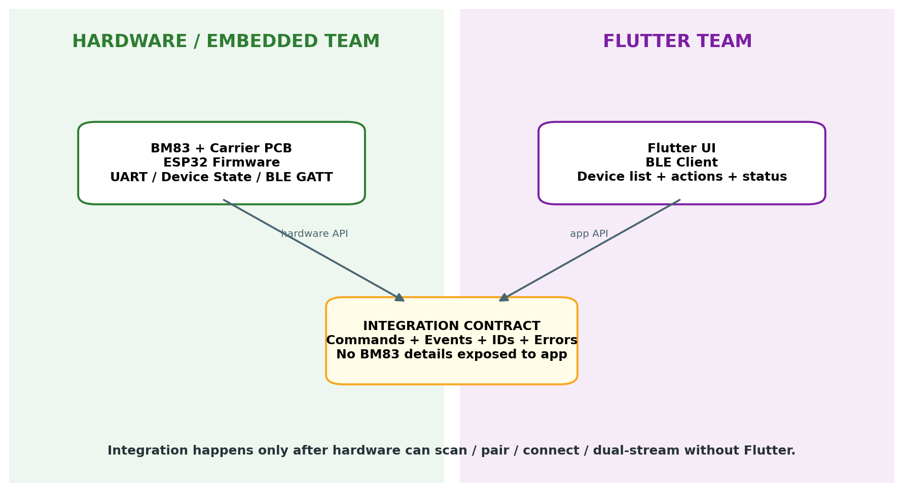
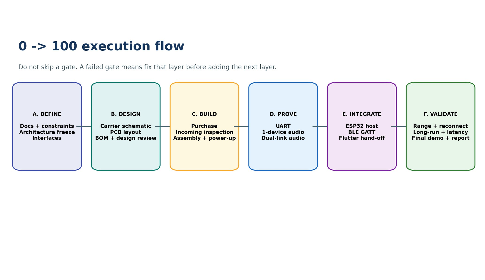

<!-- Converted from final brd(1).pdf; source page numbers retained. Diagrams saved in BT_SHARE_BRD_assets/. -->

**Original planning PDF:** [View source](../PDF/BT_SHARE_BRD.pdf)  
**Figures:** Restored directly from embedded diagrams in the matching source PDF.

<!-- Source page 1 -->

### BT SHARE

### Multi-Bluetooth Audio Hub

### BUSINESS REQUIREMENTS DOCUMENT (BRD)

### Hardware & Embedded Prototype - Two-Device Target

Hardware-first execution baseline | LKR 40,000 prototype ceiling | Flutter team developed separately and

integrated after hardware proof

Document status: Hardware Team Working Baseline | Date: 06 Oct 2026

<!-- Source page 2 -->

## 1. Executive Summary

BT Share is a proof-of-concept embedded Bluetooth audio hub. The hardware team shall build a physical prototype that accepts one stereo AUX/line-level source and transmits the same audio program to two independent Bluetooth Classic A2DP sink devices simultaneously. The prototype shall use the BM83 as the Bluetooth audio engine and the ESP32 as the control, state-management and mobile-integration controller.

The hardware team is required to reach a complete two-device working state before Flutter integration. The Flutter application is developed by a separate team. During final integration, the Flutter app will control the ESP32 over BLE GATT; the ESP32 will translate app actions into BM83 host commands over UART. The phone is a control interface only and is not part of the audio path.

Primary success statement One AUX source is heard on Bluetooth Device 1 and Bluetooth Device 2 at the same time, while the system can discover, pair, connect, disconnect and report state reliably. Flutter integration is a later layer; it must not be required to prove the core two-device hardware.

## 2. Purpose, Audience and Document Hierarchy

| Item | Defni ition |
| --- | --- |
| Purpose | Defni e exactly what the hardware/embedded team must deliver, the requirements that are mandatory, the integration boundary with Flutter, and the objective acceptance criteria. |
| Primary audience | Hardware/embedded team, project lead, test/review team, and the Flutter team at the integration boundary. |
| BRD role | This document defines WHAT must be achieved and accepted. Exact schematics, PCB layout details and BM83 command syntax belong in controlled engineering design documents. |
| Execution source | Multi Bluetooth Audio Hub BM83 0 to 100 Master Plan - build _ _ _ _ _ _ _ _ _ order, gates and workfol w. |
| Procurement source | Multi Bluetooth Audio Hub BM83 Final Company Procurement _ _ _ _ _ _ _ _ Submission - approved one-shot parts/tools/fabrication envelope. |
| Original architecture source | Multi-Bluetooth Audio Hub Flutter Control MD - original control/audio separation, two-device milestone, device management and acceptance concepts. |

Controlled planning rule If this BRD and an older draft conflict, the latest approved BRD + Master Plan + Final Company Procurement Submission form the current prototype baseline. Changes after approval must be recorded as a requirement change, not silently implemented.

<!-- Source page 3 -->

## 3. Business Problem and Prototype Objectives

### 3.1 Problem Statement

Conventional Bluetooth audio use often targets a single active receiver from a source device. The project seeks to demonstrate a dedicated external hub that can take one analog stereo source and deliver the same program to two Bluetooth audio receivers at the same time, while device selection and connection management are controlled independently from the audio path.

### 3.2 Prototype Objectives

- Prove two simultaneous Bluetooth Classic A2DP sink connections from one BM83-based transmitter architecture.  Prove stable stereo AUX input and same-source audio delivery to both receivers.  Build a deterministic ESP32 host controller for BM83 discovery, pairing, connection, state and error management.  Expose a clean BLE GATT app-facing contract on the ESP32 without exposing BM83 internals to the Flutter team.  Integrate the separately developed Flutter app only after the hardware subsystem works independently.  Complete the prototype within the approved LKR 40,000 procurement ceiling and document its actual limitations.

## 4. Scope Boundaries

### 4.1 In Scope - Hardware & Embedded Team

- BM83 carrier-board schematic, PCB layout, assembly-ready documentation and bring-up.  BM83 power, AUX input, UART host interface, reset/MFB/configuration access and test points.  One-device A2DP audio proof followed by two-device Dual-Link proof.  ESP32 firmware for BM83 host communication, discovery, pairing, connection, state, retry/recovery, logging and BLE GATT.  Hardware-facing integration contract for Flutter: commands, events, identifiers, states and error codes.  Compatibility, reconnect, range, long-run, latency-observation and final-demo qualification.  Test evidence and final prototype handover documentation.

### 4.2 Out of Scope for This Prototype

- 3-5 simultaneous Bluetooth audio receivers.  Auracast, LE Audio or BLE Audio Broadcast.  Perfect receiver synchronization or zero-latency claims.  Production enclosure, battery product design or production certification.  Final mass-production RF optimization or market-ready PCB certification.  Flutter UI implementation itself; that belongs to the separate Flutter team.  Routing or relaying the audio stream through the Flutter phone.

<!-- Source page 4 -->

## 5. Fixed System Architecture

Figure 1 - Fixed prototype architecture and separation of control path from audio path.

| Layer | Responsibility |
| --- | --- |
| Flutter App | User-facing control/status only. Connects to ESP32 over BLE GATT. |
| ESP32 | BLE GATT server, command handler, device/state manager, BM83 host controller, logging and integration boundary. |
| BM83 | Bluetooth Classic audio engine, discovery/pairing/connection under selected AT fri mware, A2DP Source, TX mode, SBC, Dual Link and AUX audio processing. |
| AUX Input | External stereo line-level source. Must not accept high-power speaker output. |
| Bluetooth Device 1 / 2 | Independent A2DP sink devices such as speaker, headphone or earbuds. |

## 6. Constraints and Non-Negotiable Decisions

| ID | Constraint / Decision | Rationale |
| --- | --- | --- |
| C-001 | First prototype target is exactly 2 simultaneous receivers. | Prevents scope creep and aligns development/test target. |
| C-002 | Total prototype procurement ceiling: LKR 40,000. | Approved project constraint. |

<!-- Source page 5 -->

| ID | Constraint / Decision | Rationale |
| --- | --- | --- |
| C-003 | BM83SM1-00TA is the selected Bluetooth audio engine; one active unit + one spare in procurement. | Protects schedule against single imported- module failure. |
| C-004 | Official BM83 evaluation board is excluded. Team-designed minimal carrier PCB is used. | Budget control and project ownership. |
| C-005 | Flutter team develops separately. | Allows parallel work and independent hardware debugging. |
| C-006 | Core hardware must work without Flutter. | Prevents UI/BLE issues from masking audio/Bluetooth faults. |
| C-007 | No display, rotary encoder or app- replacement physical UI. | Mobile app is the intended user interface. |
| C-008 | Exact BM83 pin, voltage and AT-command details must be taken from the approved fri mware/hardware documentation; no guessing. | Protects hardware and prevents protocol errors. |
| C-009 | Two receivers may have difef rent audible latency. | Dual connection does not equal perfect synchronization. |
| C-010 | Flutter phone is never in the audio data path. | Maintains architecture separation and demo clarity. |

## 7. Team Responsibilities and Ownership

| Workstream | Hardware / Embedded Team | Flutter Team |
| --- | --- | --- |
| Physical hardware | Owns BM83 carrier, power, AUX, ESP32, wiring, test points and prototype assembly. | No responsibility. |
| Bluetooth audio | Owns BM83 confgi uration, A2DP source behavior and two-receiver proof. | No responsibility. |
| BM83 host control | Owns UART protocol, parser, commands/events and device state. | No responsibility. |
| BLE transport | Owns ESP32 GATT server, UUIDs, protocol version, notifci ations and error model. | Owns BLE client implementation. |
| User functions | Implements fri mware endpoints required by the frozen integration contract. | Defni es final app function catalogue/UI actions and maps them to the contract. |
| App UI/UX | Provides hardware status semantics only. | Owns screens, navigation, UX and presentation. |
| Integration | Provides a hardware system already working without Flutter. | Provides app already working against mock/test BLE contract. |

<!-- Source page 6 -->

| Workstream | Hardware / Embedded Team | Flutter Team |
| --- | --- | --- |
| Acceptance | Joint integration test after each subsystem passes its own gate. | Joint integration test. |

Figure 2 - Team boundary and integration contract.

## 8. Business Requirements

| ID | Requirement | Priority |
| --- | --- | --- |
| BR-001 | The prototype shall demonstrate one AUX source playing through two Bluetooth A2DP sink devices simultaneously. | Must |
| BR-002 | The hardware subsystem shall reach the two-device target before Flutter integration. | Must |
| BR-003 | The prototype shall remain within the approved LKR 40,000 procurement ceiling. | Must |
| BR-004 | The system shall separate control trafcfi from audio trafcfi . | Must |
| BR-005 | The app-facing interface shall hide BM83- specifci command syntax and expose stable product-level actions/states. | Must |
| BR-006 | The system shall provide enough diagnostics to identify whether failures occur in power, UART, Bluetooth, BLE transport or app/state synchronization. | Must |

<!-- Source page 7 -->

| ID | Requirement | Priority |
| --- | --- | --- |
| BR-007 | The final demo shall clearly show Device 1, Device 2 and simultaneous playback from the same source. | Must |
| BR-008 | Limitations including latency/synchronization and compatibility shall be documented rather than overclaimed. | Must |

## 9. Functional Requirements - Hardware and Audio

| ID | Requirement | Verifci ation |
| --- | --- | --- |
| HW-001 | The carrier board shall expose safe power input, ground, UART, AUX L/R, reset/MFB/control access and required test points. | Design review + inspection |
| HW-002 | The BM83 power architecture shall comply with the approved device requirements and shall not apply unsupported voltage directly to the raw module. | Power pre-check |
| HW-003 | The stereo AUX path shall accept a normal line-level source and preserve Left/Right channels to BM83. | Audio bench test |
| HW-004 | The board layout shall preserve the BM83 antenna keep-out/orientation requirements from the approved hardware guidance. | PCB review |
| HW-005 | The carrier shall provide accessible debug/test points for the main power rail, ground, UART and audio signals. | Visual inspection |
| AUD-001 | BM83 shall operate as the A2DP Source for the prototype. | One-device audio test |
| AUD-002 | The source audio shall be encoded/transmitted using the baseline SBC path supported by the selected setup. | Configuration record + playback |
| AUD-003 | One known-good A2DP sink shall receive stable audio before any dual-link testing starts. | Gate test |
| AUD-004 | Two A2DP sinks shall receive the same source program simultaneously during the core proof. | Dual-link test |
| AUD-005 | Disconnecting one sink shall not create an undocumented failure state for the other; behavior shall be observed and recorded. | Failure injection |

<!-- Source page 8 -->

| ID | Requirement | Verifci ation |
| --- | --- | --- |
| AUD-006 | High-power speaker output shall not be used as AUX/line input. | Build/test checklist |

## 10. Functional Requirements - Bluetooth, ESP32 and Firmware

| ID | Requirement |
| --- | --- |
| BT-001 | The system shall support discovery of compatible nearby Bluetooth audio receivers using the selected BM83 fri mware path. |
| BT-002 | The system shall distinguish pairing from active connection and maintain both states correctly. |
| BT-003 | The system shall support connection of Device 1 and Device 2 and enforce a maximum-two prototype rule. |
| BT-004 | The system shall detect and report disconnects and expose a defni ed reconnect action/policy. |
| FW-001 | ESP32 shall communicate with BM83 over a verified UART electrical/protocol interface. |
| FW-002 | BM83 responses/events shall be parsed into a product-level device/state model rather than passed raw to the Flutter app. |
| FW-003 | The ESP32 shall maintain the authoritative discovered/selected/paired/connected/streaming state for each device. |
| FW-004 | Firmware shall use explicit states: UNKNOWN, DISCOVERED, SELECTED, PAIRING, PAIRED, CONNECTING, CONNECTED, STREAMING, DISCONNECTED and FAILED/RETRY as applicable. |
| FW-005 | Firmware shall implement command validation, timeouts, structured errors and structured serial logs. |
| FW-006 | The system shall recover to a known state after expected connection failure/retry paths; uncontrolled silent state loss is not acceptable. |
| FW-007 | Core device discovery/pair/connect/disconnect/dual-stream operation shall be testable from serial/diagnostic control before BLE/Flutter integration. |
| FW-008 | BLE control activity shall not interrupt normal A2DP audio streaming under normal prototype operation. |

<!-- Source page 9 -->

## 11. Flutter Integration Requirements and Function Handover

Important dependency The Flutter team has not yet issued the final function catalogue. Hardware firmware must therefore be architected around a stable product-level command/event contract and mockable handlers. When Flutter provides its final list, the hardware team maps the approved functions to these handlers without changing the audio architecture.

### 11.1 Provisional Minimum App Function Baseline

| ID | Function | Hardware expectation |
| --- | --- | --- |
| APP-F01 | Connect to BT Share hub | BLE connection to ESP32; show hub ready/not ready. |
| APP-F02 | Start receiver scan | Request BM83 discovery through ESP32. |
| APP-F03 | Display discovered devices | Show name/identifier and current state from ESP32. |
| APP-F04 | Select Device 1 | Assign one discovered device to slot 1. |
| APP-F05 | Select Device 2 | Assign one discovered device to slot 2; reject third active selection. |
| APP-F06 | Pair device | Send pair request and show progress/result. |
| APP-F07 | Connect device | Connect selected/paired receiver and show state. |
| APP-F08 | Disconnect device | Disconnect one selected receiver and update state. |
| APP-F09 | Reconnect request | Request reconnect for an eligible disconnected receiver. |
| APP-F10 | View status | Show connected/disconnected/streaming states for both slots. |
| APP-F11 | View errors | Display clear pairing/connection/max- link/BM83 communication errors. |
| APP-F12 | Development log/status view | Optional development screen for protocol/status diagnostics during integration. |

### 11.2 Flutter Team Function Catalogue Required Before Integration Freeze

Flutter team shall return a function list using the following fields. Hardware shall not guess UI behavior that is not supplied.

| Field | What Flutter team must provide |
| --- | --- |
| Function ID | Stable ID/name for each user action. |

<!-- Source page 10 -->

| Field | What Flutter team must provide |
| --- | --- |
| UI action | What the user taps/selects/requests. |
| Command intent | What hardware action is expected. |
| Parameters | Device ID, slot number or other required data. |
| Expected response | Immediate acknowledgement and/or final event. |
| Status shown | What state the app needs to display. |
| Error cases | What errors must be surfaced to the user. |
| Priority | Must / Should / Optional for fri st prototype. |
| Screen owner | Which Flutter screen/function consumes it. |

### 11.3 Draft Hardware-to-App Event Model

| ID | Event | Meaning |
| --- | --- | --- |
| EVT-01 | HUB READY _ | ESP32 + BM83 control stack ready. |
| EVT-02 | SCAN STARTED _ | Discovery accepted/started. |
| EVT-03 | DEVICE FOUND _ | One device record added/updated. |
| EVT-04 | SCAN COMPLETE _ | Discovery cycle ended. |
| EVT-05 | PAIRING | Pairing in progress. |
| EVT-06 | PAIRED | Trusted relationship established. |
| EVT-07 | CONNECTING | Profile connection in progress. |
| EVT-08 | CONNECTED | Receiver connected. |
| EVT-09 | STREAMING | Receiver link is in streaming state where supported by status model. |
| EVT-10 | DISCONNECTED | Receiver link ended. |
| EVT-11 | MAX LINKS REACHED _ _ | Two-device prototype limit prevents another active link/selection. |
| EVT-12 | ERROR | Structured error code + context supplied. |

## 12. Device and State Data Model

| Field | Required meaning |
| --- | --- |
| deviceId / address | Stable identifier used by hardware and app contract. |

<!-- Source page 11 -->

| Field | Required meaning |
| --- | --- |
| name | Human-readable Bluetooth device name where available. |
| paired | Trusted relationship status. |
| selectedSlot | None, Device 1 or Device 2. |
| connected | Active Bluetooth proflie link status. |
| connectionState | Product-level state such as DISCOVERED/PAIRING/CONNECTED/STREAMING. |
| lastSeen | Timestamp/counter useful for scan list maintenance. |
| errorCode | Structured error when the latest operation fails. |

State ownership rule: ESP32 is the source of truth for the product-level device list and connection state presented to Flutter. Flutter displays/sends user intent; it does not independently invent connection state.

## 13. Non-Functional Requirements

| ID | Category | Requirement |
| --- | --- | --- |
| NFR-001 | Reliability | Prototype must complete repeated connect/disconnect cycles without uncontrolled ESP32/BM83 resets. |
| NFR-002 | Diagnostics | Every major command and state transition shall be visible in structured serial logs during development. |
| NFR-003 | Recoverability | Disconnect/out-of-range/failed connection shall result in an explicit recoverable state, not a frozen UI/system. |
| NFR-004 | Maintainability | Firmware shall separate BLE transport, app protocol, state manager and BM83 driver/protocol responsibilities. |
| NFR-005 | Testability | Core hardware functions shall be testable without Flutter. |
| NFR-006 | Budget | Procurement shall not exceed LKR 40,000 without re-approval. |
| NFR-007 | Safety | Low-voltage electronics work shall follow the approved lab/company safety process; powered/hot-tool work is supervised. |
| NFR-008 | Transparency | Latency/synchronization and compatibility limitations shall be measured/observed and reported honestly. |
| NFR-009 | Scope control | No 3-5 device, Auracast, display or production-product work may delay the two-device prototype. |

<!-- Source page 12 -->

| ID | Category | Requirement |
| --- | --- | --- |
| NFR-010 | Integration stability | BLE command/status handling shall not intentionally route or process the audio stream on ESP32/Flutter. |

## 14. Requirement-Driven Execution Plan

Figure 3 - Approved 0-to-100 execution flow. A failed gate is fixed before the next layer is added.

| Phase | Work | Exit gate |
| --- | --- | --- |
| P0 - Defni e | Freeze BRD, constraints, interfaces and reference docs. | BRD accepted; no architecture drift. |
| P1 - Design | Carrier schematic, exact BOM mapping, PCB layout, RF review, Gerbers. | Design review + ERC/DRC pass. |
| P2 - Build | Receive parts, inspect, assemble carrier, electrical pre-check. | Safe/stable power rails; no short. |
| P3 - BM83 Bring-up | UART response, firmware/confgi uration verification, Tx/Host/AUX setup. | BM83 alive and controllable. |
| P4 - One Device | AUX -> BM83 -> one receiver. | Stable audible playback. |
| P5 - Two Device Core Proof | AUX -> BM83 -> Device 1 + Device 2. | Same source heard on both. |
| P6 - ESP32 Host | UART driver/protocol, state machine, discovery/pair/connect/disconnect. | Full serial-controlled hardware fol w. |

<!-- Source page 13 -->

| Phase | Work | Exit gate |
| --- | --- | --- |
| P7 - BLE GATT | Freeze product-level BLE contract and test with generic client. | BLE commands/events stable. |
| P8 - Flutter Integration | Map Flutter functions to frozen contract. | App can control two-device fol w. |
| P9 - Validate | Compatibility, reconnect, range, long-run, latency observation and fni al demo. | Acceptance matrix passed/documented. |

## 15. Pre-Arrival Work - Approx. 10-Day Delivery Window

The team shall not wait for physical parts. The purpose of this window is to finish everything that can be completed without the hardware so arrival triggers assembly and bring-up immediately.

| Day | Mandatory output |
| --- | --- |
| Day 1 | Archive ofcfi ial BM83 docs; create pin/function and fri mware capability sheets; close open assumptions. |
| Day 2 | Freeze carrier interfaces and power/AUX/UART/reset/test-point requirements. |
| Day 3 | Complete carrier schematic V1; perform net-by-net review. |
| Day 4 | Freeze schematic BOM mapping to the already approved procurement stock; peer review. |
| Day 5 | Complete PCB layout, antenna keep-out review, DRC and Gerber release. |
| Day 6 | Create ESP32 fri mware repository, logger, state model, command shell and BM83 driver interfaces. |
| Day 7 | Build mock BM83 response parser/tests and command timeout/error framework. |
| Day 8 | Defni e BLE UUID/protocol draft, events and Flutter handover template. |
| Day 9 | Prepare bring-up, one-device, dual-link, reconnect, range and long-run test sheets. |
| Day 10 | Final cross-check: schematic/PCB/fri mware/protocol/test documents ready; receiving checklist ready. |

Expected readiness before parts arrive Carrier schematic reviewed; PCB Gerbers ready/released; firmware project compiles; mock UART parser works; BLE draft contract issued; test sheets and receiving checklist prepared.

<!-- Source page 14 -->

## 16. Procurement and Hardware Baseline

The detailed purchase links/prices are controlled in the Final Company Procurement Submission. This BRD defines only the required hardware classes and ownership relationship.

| Item | Prototype role | Status |
| --- | --- | --- |
| BM83SM1-00TA x2 | One operational Bluetooth audio engine + one imported spare. | Approved procurement baseline |
| ESP32 DevKit / ESP-WROOM-32 with CP2102 | Main controller and BLE GATT server. | Approved procurement baseline |
| Team-designed BM83 Carrier PCB | Replaces the expensive ofcfi ial BM83 EVB. | Engineering design deliverable |
| 3.5 mm stereo AUX interface | External line-level audio input. | Required |
| Power/regulation/passives/connectors/test points | Safe BM83 carrier operation and debugging. | Required |
| USB-UART/debug interfaces | BM83/ESP32 bring-up and diagnostics. | Required |
| Bluetooth test receivers | At least two independent compatible sinks; mixed types/brands preferred. | Team/company-owned where possible |
| Multimeter/soldering/prototyping tools | Build and verification tools. | Procurement/company lab baseline |

Procurement control The detailed procurement document remains the price/seller/quantity authority. This BRD must not be used as a substitute for the company purchase pack.

## 17. Verification and Test Requirements

| Test | Scenario | Pass evidence | Covers |
| --- | --- | --- | --- |
| T-01 | Carrier electrical pre-check | No unintended shorts; expected low-voltage rails available before BM83 operation. | HW-001/002 |
| T-02 | BM83 UART bring-up | Valid BM83 response/activity under approved setup. | FW-001 |
| T-03 | Single sink playback | AUX -> BM83 -> one speaker/headphone produces stable audio. | AUD-001/003 |
| T-04 | Dual-link playback | Same source program audible on two independent sinks simultaneously. | BR-001, AUD-004 |
| T-05 | Discovery | Compatible receiver appears in ESP32 product device list. | BT-001, FW-002/003 |

<!-- Source page 15 -->

| Test | Scenario | Pass evidence | Covers |
| --- | --- | --- | --- |
| T-06 | Pairing/connection | Pair and connect fol ws transition through explicit states. | BT-002/003 |
| T-07 | Disconnect/reconnect | One link drops/reconnects and state/errors remain correct. | BT-004, NFR-003 |
| T-08 | Maximum-link behavior | Third active selection/link request returns max-link state/error. | BT-003 |
| T-09 | BLE generic client | Scan/select/pair/connect/status commands work through BLE without Flutter. | BR-002, FW-007 |
| T-10 | Flutter integration | Flutter performs approved functions against same frozen contract. | BR-005 |
| T-11 | Mixed devices | Speaker+headphone, speaker+earbuds or equivalent mixed pair works/documented. | BR-008 |
| T-12 | Range | Record actual 1m/3m/5m/practical-room behavior. | NFR-008 |
| T-13 | Long run | 30 min, 1 h and 2 h streaming observations recorded. | NFR-001 |
| T-14 | Power cycle/recovery | System returns to a known state after defni ed restart/recovery tests. | NFR-003 |
| T-15 | Latency observation | Difef rence between receiver outputs measured/observed and documented; no perfect-sync claim. | BR-008 |

## 18. Acceptance Criteria - Hardware Team Definition of DONE

| ID | Acceptance criterion |
| --- | --- |
| AC-01 | BM83 carrier powers reliably and BM83/ESP32 are stable. |
| AC-02 | AUX stereo input is functional. |
| AC-03 | One compatible A2DP sink can be discovered, paired, connected and streamed. |
| AC-04 | Two compatible A2DP sinks can be connected simultaneously and both receive the same source program. |
| AC-05 | ESP32 controls BM83 through UART and maintains correct product-level device/state information. |
| AC-06 | Serial diagnostics can execute the full core flow without Flutter. |

<!-- Source page 16 -->

| ID | Acceptance criterion |
| --- | --- |
| AC-07 | ESP32 BLE GATT can execute the approved control/status contract with a generic BLE test client. |
| AC-08 | Flutter integration can scan/select/pair/connect/disconnect/reconnect and display status/errors using the frozen contract. |
| AC-09 | Disconnect/reconnect and max-link behaviors are explicit and documented. |
| AC-10 | No unacceptable continuous audio dropouts occur during the agreed demo test. |
| AC-11 | Range, long-run and latency/synchronization observations are documented. |
| AC-12 | All fni al design, fri mware, interface and test evidence is archived for handover. |

## 19. Risk Register and Required Mitigation

| ID | Risk | Impact | Mitigation |
| --- | --- | --- | --- |
| R-01 | Wrong/incompatible BM83 fri mware/confgi uration | High | Verify exact module/fri mware behavior before depending on commands or Dual Link; keep confgi uration record. |
| R-02 | Carrier PCB design error | High | Net-by-net review, official footprint/pin references, ERC/DRC, accessible test points and spare PCBs. |
| R-03 | BM83 module damaged/DOA | High | Procure one spare BM83; inspect and follow approved low-voltage bring-up process. |
| R-04 | UART electrical/protocol mismatch | High | Verify voltage/interface and protocol details before connection; debug with structured logs. |
| R-05 | One-device audio not stable | High | Do not attempt dual-link/Flutter; isolate power, AUX, A2DP, pairing and confgi uration fri st. |
| R-06 | Two receivers have audible delay difference | Medium | Document as expected limitation; do not claim synchronization. |
| R-07 | Flutter requirements arrive late/change | Medium | Use provisional product-level handlers; require final function catalogue before integration freeze. |

<!-- Source page 17 -->

| ID | Risk | Impact | Mitigation |
| --- | --- | --- | --- |
| R-08 | Budget overrun | Medium | Procurement ceiling is binding; re-approval required before exceeding LKR 40,000. |
| R-09 | Integration failure across many layers | Medium | Classify failure as BLE transport, protocol, state synchronization or BM83/hardware; debug one layer at a time. |
| R-10 | Demo device incompatibility | Medium | Qualify a known-good primary pair and backup pair before demo day. |

## 20. Required Hardware-Team Deliverables

| ID | Deliverable | Minimum content |
| --- | --- | --- |
| D-01 | Approved Hardware & Embedded BRD | This document. |
| D-02 | BM83 Firmware/Capability Study | Exact fri mware/confgi uration, required commands/events and open/closed assumptions. |
| D-03 | Carrier Schematic + Design Review | Power, AUX, UART, reset/MFB/config/recovery and test points. |
| D-04 | Carrier PCB Package | PCB layout, Gerbers, fabrication notes and revision ID. |
| D-05 | ESP32 Firmware Architecture | Modules, state machine, BM83 driver/protocol, BLE, storage/logging. |
| D-06 | BM83 Command/Event Mapping | Product operations mapped to exact verified BM83 commands/events. |
| D-07 | BLE Integration Contract | UUIDs, protocol version, commands, events, data model and error codes. |
| D-08 | Flutter Function Mapping | Final Flutter team catalogue mapped to hardware endpoints. |
| D-09 | Single-Device Test Report | Audio/connection/stability evidence. |
| D-10 | Dual-Device Test Report | Same-source two-receiver proof and disconnect/reconnect evidence. |
| D-11 | Compatibility/Range/Long-Run/Latency Report | Final validation results and known limitations. |
| D-12 | Final Prototype Test & Demo Report | Acceptance matrix, fni al setup and demo evidence. |

<!-- Source page 18 -->

## 21. Requirements Traceability Matrix

| Business Req | Derived requirement | Verifci ation | Evidence |
| --- | --- | --- | --- |
| BR-001 | AUD-003/004, BT-003 | T-03/T-04 | D-09/D-10 |
| BR-002 | FW-007 | T-09 | D-05/D-07 |
| BR-003 | NFR-006 | Procurement review | Final procurement submission |
| BR-004 | FW-002, NFR-010 | Architecture review + T-10 | D-05/D-07 |
| BR-005 | FW-002, APP-F01..12 | T-09/T-10 | D-07/D-08 |
| BR-006 | FW-005, NFR-002 | Log review during all tests | D-05/D-12 |
| BR-007 | AUD-004, AC-04 | Final demo | D-12 |
| BR-008 | NFR-008 | T-11/T-12/T-15 | D-11/D-12 |

## 22. Change Control and Integration Freeze Rules

- Architecture-changing requests require project-lead approval and BRD update before implementation.  Flutter UI changes that do not alter hardware commands/events may proceed without hardware architecture changes.  New Flutter functions that require new hardware behavior must be added to the function catalogue and mapped to a requirement ID before firmware work starts.  Exact BM83 commands/packet details may be refined during firmware study without changing the product-level app contract, provided behavior remains equivalent.  No new feature may delay AC-04: two simultaneous receivers playing the same AUX source.  After BLE integration contract freeze, UUID/protocol breaking changes require coordinated Flutter + hardware sign- off.

## 23. Final Demonstration Flow

1. Power the approved prototype and allow ESP32/BM83 initialization to reach HUB_READY. 2. Connect the Flutter app to the ESP32 over BLE. 3. Start a receiver scan and display discovered compatible devices. 4. Select Device 1 and Device 2. 5. Pair/connect both receivers through the app-controlled hardware path. 6. Connect/play a known-good stereo AUX source. 7. Demonstrate audible playback on Device 1. 8. Demonstrate audible playback on Device 2. 9. Demonstrate both receiving the same source program simultaneously. 10. Optionally perform one controlled disconnect/reconnect if the qualified demo script includes it. 11. Show status/error handling and state updates in the app. 12. State documented prototype limitations honestly: latency difference, compatibility variation and two-device scope.

Demo success The final demo is successful when the two-device audio proof and app control/status proof both work, while the audio path remains AUX -> BM83 -> Bluetooth receivers.

<!-- Source page 19 -->

## 24. Hardware Team Start Checklist

| Start item | Status |
| --- | --- |
| Architecture frozen to BM83 + ESP32 + AUX + two sinks | [ ] |
| Final procurement submission approved/ordered | [ ] |
| Official BM83 document pack archived | [ ] |
| Carrier schematic owner assigned | [ ] |
| PCB review owner assigned | [ ] |
| ESP32 fri mware repository created | [ ] |
| Mock BM83 parser/state model started | [ ] |
| BLE integration contract owner assigned | [ ] |
| Flutter team requested to return final function catalogue | [ ] |
| Test templates created | [ ] |
| Known-good two-receiver demo candidates identifei d | [ ] |

## 25. Final BRD Statement

This BRD authorizes the hardware/embedded team to proceed with the two-device BT Share prototype using the current BM83 + ESP32 execution baseline. The team shall design and prove the hardware first, complete the ESP32 host/control layer second, expose a stable BLE contract third, and integrate the separately developed Flutter application only after the standalone hardware subsystem is already functional.

The single most important product requirement is unchanged throughout the project: one external AUX source must be transmitted through the BM83 to two independent Bluetooth A2DP receivers simultaneously. All planning, procurement, firmware, testing and integration work shall support this requirement and shall not be diverted by future-product features.

| Approval | Name | Signature / Date |
| --- | --- | --- |
| Project Lead |  |  |
| Hardware / Embedded Lead |  |  |
| Flutter / Integration Representative |  |  |
| Reviewer / Mentor |  |  |

