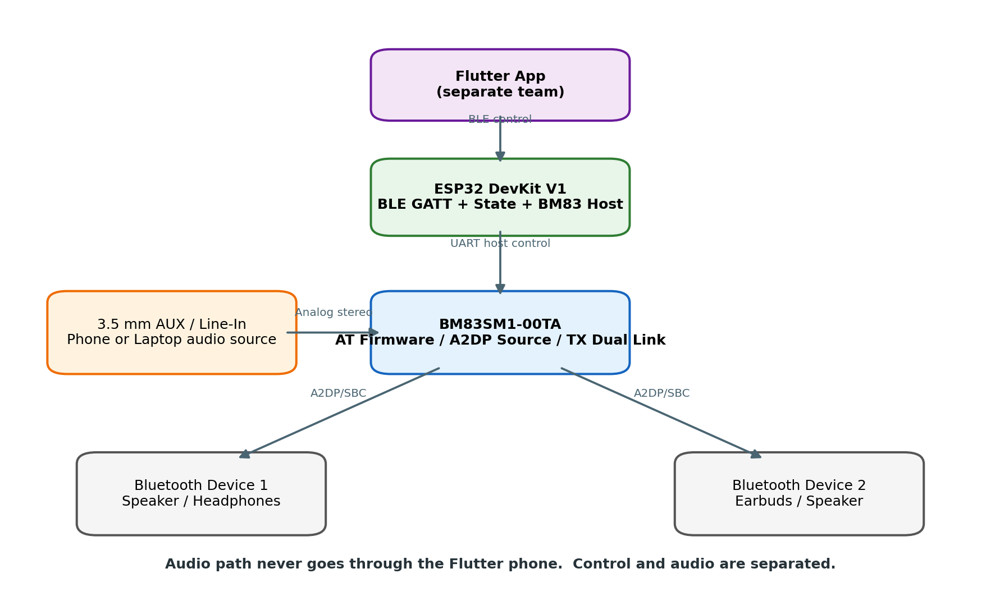
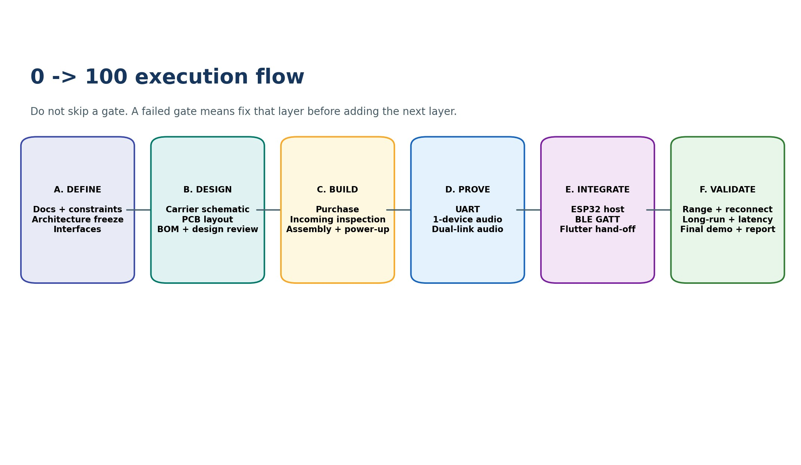

<!-- Converted from plan(1).pdf; source page numbers retained. Diagrams saved in BT_SHARE_Execution_Plan_assets/. -->

**Original planning PDF:** [View source](../PDF/BT_SHARE_Execution_Plan.pdf)  
**Figures:** Restored directly from embedded diagrams in the matching source PDF.

<!-- Source page 1 -->

### BT SHARE

### Hardware & Embedded Execution Planning

From approved BRD + procurement package to a two-device working prototype

PLAN PURPOSE

This document is the day-to-day execution plan. The BRD defines WHAT must be achieved; the procurement PDF

defines WHAT is being purchased; this plan defines WHEN, IN WHAT ORDER, BY WHOM, WITH WHAT OUTPUTS and

WHICH GATES must pass before the next layer starts.

| Current project state | BRD ready \| Final purchase list ready \| Hardware delivery pending |
| --- | --- |
| Core target | One AUX source -> BM83 -> two simultaneous Bluetooth A2DP receivers |
| Controller | ESP32 DevKit V1; UART host control to BM83; BLE GATT to Flutter |
| Budget ceiling | LKR 40,000 prototype procurement ceiling |
| Document status | Execution baseline for next work start |

<!-- Source page 2 -->

## 1. Planning Basis and Current Position

This plan is controlled by the final BRD and final company procurement submission. It does not replace them.

### 1.1 Source-of-truth documents

| Document | What it controls |
| --- | --- |
| BT Share Hardware & Embedded BRD Final | Requirements, scope, architecture, ownership, integration boundary and acceptance criteria. |
| BM83 Final Company Procurement Submission V2 | Approved one-shot components/tools/fabrication envelope, budget caps, delivery-window tasks and purchasing constraints. |
| Original Multi-Bluetooth Audio Hub MD | Original audio/control separation, two-device milestone, device/state concepts and testing intent. |

### 1.2 Current status

| Item | Status | Meaning |
| --- | --- | --- |
| Architecture | LOCKED | Single BM83 audio engine + ESP32 host controller; Flutter is control only. |
| Target | LOCKED | Exactly two simultaneous A2DP sink devices for the first prototype. |
| Procurement | READY / SUBMITTED | Parts/tools/PCB envelope prepared under LKR 40,000. |
| Flutter team | PARALLEL | App team develops separately against a product-level BLE contract. |
| Hardware execution | START NOW | Pre-arrival engineering work begins immediately; do not wait for deliveries. |
| NON-NEGOTIABLE END STATE Hardware must fri st prove AUX -> BM83 -> Device 1 + Device 2 without requiring Flutter. Only after that proof do we integrate BLE and the app. |  |  |

<!-- Source page 3 -->

## 2. Fixed System Architecture

The architecture shall not drift during prototype execution.

Control path: Flutter App -> BLE GATT -> ESP32 -> UART -> BM83.

Audio path: AUX / line-level source -> BM83 -> A2DP/SBC -> Bluetooth Device 1 + Bluetooth Device 2.

ARCHITECTURE RULE

The Flutter phone never carries the audio stream. ESP32 manages control/state. BM83 is the Bluetooth Classic audio

engine. A failed control layer must not be confused with an audio-path failure.

<!-- Source page 4 -->

## 3. Execution Rules and Gate Discipline

Every phase has a measurable exit gate. A failed gate is fixed before the next layer is added.

| Rule | Execution requirement |
| --- | --- |
| R1 - No guessing | BM83 pins, voltages, fri mware capabilities and AT commands come from the approved exact documentation only. |
| R2 - One layer at a time | Power -> UART -> one-device audio -> dual-device audio -> ESP32 control -> BLE -> Flutter. |
| R3 - Hardware before Flutter | Core two-device proof must work without the Flutter application. |
| R4 - Evidence required | Every gate produces a log, checklist, screenshot/photo, test record or versioned engineering file. |
| R5 - Budget discipline | Unused budget headroom remains contingency; it is not permission for feature expansion. |
| R6 - Scope control | No 3-5 device work, Auracast, display, battery product design or enclosure work may delay the two-device proof. |
| R7 - Safe workshop process | Hot-tool or mains-powered workshop tasks are company/lab managed and performed under experienced adult supervision; this plan does not provide operating procedures. |

### 3.1 Gate naming

G0 Design Ready -> G1 Electrical Ready -> G2 BM83 Alive -> G3 One-Device Audio -> G4 Two-Device Core Proof -> G5 ESP32 Host Control -> G6 BLE Contract Stable -> G7 Flutter Integration -> G8 Validation / Demo Ready.

<!-- Source page 5 -->

## 4. Master 0-to-100 Roadmap

This is the full execution order from today to final demonstration.

| Phase | Main work | Exit gate |
| --- | --- | --- |
| P0 Defni e | Freeze BRD, interfaces, source documents and assumptions. | G0: baseline accepted; no architecture drift. |
| P1 Design | Carrier schematic, BOM mapping, PCB layout, RF review, Gerbers. | G0/G1: ERC/DRC/design review pass. |
| P2 Build | Receive, inspect, assemble carrier, electrical pre-check. | G1: no short; expected rails stable. |
| P3 BM83 Bring-up | UART response, fri mware/host/TX/AUX confgi uration verifci ation. | G2: BM83 alive and controllable. |
| P4 One Device | AUX -> BM83 -> one receiver. | G3: stable audible playback. |
| P5 Two Device | AUX -> BM83 -> Device 1 + Device 2. | G4: same source heard on both. |
| P6 ESP32 Host | UART driver/parser/state machine; discovery/pair/connect/disconnect. | G5: full serial-controlled hardware flow. |
| P7 BLE GATT | Product-level BLE service, commands, events and errors. | G6: generic BLE client passes. |
| P8 Flutter | Map app functions to frozen BLE contract. | G7: app controls two-device flow. |
| P9 Validate | Compatibility, reconnect, range, long-run, latency observation, demo. | G8: acceptance matrix passed/documented. |

<!-- Source page 6 -->

## 5. Pre-Arrival Plan - Days 1 to 5

Goal: complete design work while the purchased hardware is in transit.

| Day | Primary work | Mandatory output / evidence |
| --- | --- | --- |
| Day 1 | Create ofcfi ial BM83 document pack. Freeze exact -00TA hardware/fri mware docs, pin functions, power limits, host/TX/AUX capabilities and open assumptions. | Document Register + Pin/Function Sheet + Firmware Capability Sheet + Open-Issue List. |
| Day 2 | Freeze carrier-board interfaces: power, AUX L/R, UART, MFB/reset/control, test points, programming/recovery access and connector strategy. | Carrier Interface Specifci ation V1. |
| Day 3 | Complete carrier schematic V1 and perform net-by-net review against the approved documentation. | KiCad schematic V1 + ERC report + review checklist. |
| Day 4 | Reconcile schematic against the approved procurement BOM; confri m every required value/connector/tool is covered. Start PCB placement/routing. | Schematic-to-BOM matrix + placement draft. |
| Day 5 | Complete PCB layout; check BM83 footprint/orientation, antenna keep-out, ground/power/audio routing and test points. Run DRC and export manufacturing flies. | KiCad PCB V1 + DRC pass + Gerber/drill package + assembly drawing + PCB release sign-of.f |
| DAY-5 DECISION GATE If schematic/PCB review fails, do not release fabrication. Fix the design fri st even if it moves the schedule. A wrong board costs more time than a one-day design correction. |  |  |

<!-- Source page 7 -->

## 6. Pre-Arrival Plan - Days 6 to 10

Goal: finish firmware skeleton, protocol contract and test documentation before hardware arrives.

| Day | Primary work | Mandatory output / evidence |
| --- | --- | --- |
| Day 6 | Create ESP32 repository and fri mware skeleton: logger, command shell, state model, UART abstraction and BM83 driver interfaces. | Firmware project builds successfully; versioned repository structure. |
| Day 7 | Build BM83 command/event map from exact AT documentation. Implement mock response parser, timeout framework and structured error model. | Verifei d command/event matrix + mock UART tests + parser test log. |
| Day 8 | Define BLE GATT draft and Flutter handover contract: UUIDs, protocol version, commands, events, device IDs/states and errors. | BLE Interface Contract V0.1 + Flutter Function Catalogue Template. |
| Day 9 | Prepare controlled test sheets: receiving, electrical pre-check, BM83 bring-up, UART, one-device A2DP, Dual Link, reconnect, range, long-run and latency observation. | Test Pack V1 + log templates + evidence naming convention. |
| Day 10 | Run readiness review: verify docs, design flies, fri mware build, protocol draft, PCB status and receiving checklist. | Pre-Arrival Readiness Sign-of.f Team can begin physical work immediately on delivery. |

### 6.1 Required state before parts arrive

- [ ] Carrier schematic reviewed and version tagged.  [ ] PCB layout, Gerbers and drill files approved/released.  [ ] Carrier BOM mapped to purchased stock.  [ ] ESP32 firmware project compiles with mock interfaces.  [ ] BM83 parser accepts mock events and handles timeouts/errors.  [ ] BLE draft contract issued to Flutter team.  [ ] Test sheets and receiving checklist ready.

<!-- Source page 8 -->

## 7. Engineering Deliverables Before Parts Arrive

These files make the team build-ready instead of planning again after delivery.

| Deliverable | Owner | Acceptance condition |
| --- | --- | --- |
| D01 - BM83 Document Register | Bluetooth / Hardware | Exact approved datasheet, hardware guide, AT/fri mware release notes and relevant reference design archived. |
| D02 - Carrier Interface Specification | Hardware | Power, AUX, UART, control and test interfaces defni ed with no unknown pins. |
| D03 - Carrier Schematic V1 | Hardware | ERC clean or reviewed exceptions documented; all nets trace to approved docs. |
| D04 - PCB + Gerber Package V1 | Hardware | DRC pass; antenna keep-out/orientation reviewed; manufacturing flies complete. |
| D05 - Schematic-to-Procurement Matrix | Hardware / Procurement | Every populated component has a procurement source or approved stock item. |
| D06 - ESP32 Firmware Skeleton | Firmware | Build succeeds; modules and interfaces exist; no hardware dependency required for compile. |
| D07 - BM83 Command/Event Matrix | Firmware / Bluetooth | Only documented commands/events; parameters and expected responses recorded. |
| D08 - BLE Integration Contract V0.1 | Firmware / Flutter liaison | Commands, events, IDs, states, errors and versioning defni ed. |
| D09 - Test Pack V1 | Test / Documentation | All gate tests have steps, expected result fei lds and evidence fei lds. |
| D10 - Receiving & Bring-up Checklist | Hardware / Test | Part-number/quantity/inspection and bring-up readiness checks prepared. |

<!-- Source page 9 -->

## 8. Carrier PCB Design Work Plan

The carrier replaces the expensive official BM83 evaluation board for this prototype. It is a debug-oriented

engineering board, not a production product PCB.

### 8.1 Schematic blocks that must exist

| Block | Planning requirement |
| --- | --- |
| BM83 core | Correct module symbol/footprint/orientation and required documented pins. |
| Power | Documented BM83 supply architecture, decoupling/bulk components, safe input connector and test point. |
| AUX / line input | Stereo Left/Right path using approved/reference values; line- level only. |
| UART host | TX/RX/GND interface to ESP32/USB-UART with verified electrical levels. |
| Control / recovery | MFB/reset/configuration access as required by the selected fri mware/hardware guidance. |
| Debug | Test points for power, ground, UART and audio; clear labels and revision marking. |
| RF | Antenna keep-out/orientation rules preserved; no routing/copper violation in restricted area. |

### 8.2 Review checklist before Gerber release

- Symbol-to-footprint mapping checked against official dimensions.  Power input voltage path reviewed independently; unsupported direct voltage is not allowed.  AUX jack channel mapping verified: Left / Right / Ground.  UART direction labels checked: ESP32 TX -> BM83 RX, ESP32 RX <- BM83 TX.  All required grounds/common references present.  Test points accessible after BM83 is mounted.  No connector/header blocks the antenna region.  Board revision, pin labels and polarity/orientation marks visible.  ERC/DRC results stored with the project release.

<!-- Source page 10 -->

## 9. Firmware Preparation Plan

Firmware is built in layers so BM83, state logic, BLE and Flutter can be debugged independently.

### 9.1 ESP32 module architecture

| Module | Responsibility | Pre-hardware test |
| --- | --- | --- |
| Logger | Structured logs with timestamps/categories. | Boot and mock transitions visible. |
| CommandShell | Development serial commands for SCAN / PAIR / CONNECT / DISCONNECT / STATUS. | Command validation with mock handlers. |
| BM83Driver | UART transport, framing and low-level BM83 command send/receive. | Mock transport + timeout tests. |
| BM83Protocol | Decode documented BM83 responses/events into typed events. | Recorded/mock packets parsed correctly. |
| DeviceManager | Discovered devices, identifei rs, selected slots and last-seen data. | Unit/mock state updates. |
| PairingManager | Pairing request and result handling. | State transitions validated. |
| ConnectionManager | Device 1/2 link management, max-two rule, reconnect policy. | Failure/retry paths simulated. |
| StateManager | Authoritative product-level state model. | Transition table tests. |
| BLEManager / GATT | App-facing service, commands, notifications and protocol version. | Generic/mock client later; compile now. |
| Storage | Optional paired-device/settings persistence once behavior is stable. | Interface stub only at first. |
| SOURCE OF TRUTH ESP32 owns the product-level device and connection state shown to Flutter. Raw BM83 command strings/events are translated inside firmware and are not exposed directly to the app. |  |  |

<!-- Source page 11 -->

## 10. Flutter Interface Planning and Team Handover

The Flutter team develops separately. Integration begins only after the hardware subsystem reaches the two-device

core proof and the BLE contract is stable.

### 10.1 Provisional function baseline to reserve in firmware

| Function | Hardware-side endpoint/state needed |
| --- | --- |
| Connect to BT Share hub | BLE session + HUB READY / not-ready state. _ |
| Start receiver scan | SCAN request -> BM83 discovery -> device notifci ations. |
| Display devices | Device ID/address, name and current state from ESP32. |
| Select Device 1 / Device 2 | Slot assignment; reject a third active selection/link. |
| Pair | PAIR request + progress/result event. |
| Connect | CONNECT request + CONNECTING/CONNECTED/STREAMING state. |
| Disconnect | DISCONNECT request + state update. |
| Reconnect | Defined reconnect request for eligible device. |
| Status | Both device slots + hub/BM83 readiness + error state. |
| Errors | Structured code + context: pairing, connection, max links, BM83 communication, timeout. |

<!-- Source page 12 -->

## 11. Parts Arrival - Receiving and Build Readiness

Physical work starts only after incoming parts are checked against the approved procurement list.

| Step | Work | Evidence / exit |
| --- | --- | --- |
| A1 Receive | Check invoice/PO against part numbers, quantities and substitutions. | Receiving checklist signed. |
| A2 Inspect | Check visible shipping/handling damage, BM83 marking, ESP32 board revision, connectors, tools and PCB revision. | Photo record + discrepancy list. |
| A3 Sort | Separate project parts, spare BM83, passives, tools and consumables into labelled containers. | Inventory map complete. |
| A4 PCB verify | Confri m carrier PCB revision, orientation markings, drill/edge quality and no obvious fabrication defect. | PCB incoming inspection pass. |
| A5 Build pack | Prepare approved schematic, assembly drawing, BOM and inspection checklist at the bench. | Only current revision available at bench. |
| A6 Supervised assembly | Carrier assembly occurs under the company/lab-supervised electronics process. | Visual inspection pass; no unapproved rework. |
| A7 Electrical pre-check | Continuity/short/power-rail checks against the approved checklist before BM83 bring- up. | G1: electrical readiness pass. |
| STOP CONDITION Any wrong part, visible damage, short, unexpected rail or unresolved PCB mismatch stops bring-up until corrected. Do not continue simply to stay on schedule. |  |  |

<!-- Source page 13 -->

## 12. BM83 Bring-up and One-Device Proof

Do not add ESP32 or Flutter complexity until the BM83 audio engine is proven independently.

### 12.1 BM83 bring-up sequence

| Gate | Objective | Pass evidence |
| --- | --- | --- |
| G1 Electrical Ready | Approved low-voltage pre-check complete; no short and expected supply behavior. | Checklist + measured values recorded. |
| G2 BM83 Alive | Verify UART response and expected fri mware/host/TX/AUX behavior. | UART log + firmware/config record. |
| G3 One-Device Audio | AUX -> BM83 -> one known-good Bluetooth receiver; stable sound. | Audio test record; device ID/name; playback observation. |

### 12.2 One-device test observations

- Discovery and target device visibility.  Pairing result and whether a trusted relationship is retained as expected.  A2DP connection state and audio start behavior.  Left/right audio presence and obvious distortion/noise/dropout observation.  Basic range/reconnect behavior sufficient to proceed to Dual Link.  Any undocumented behavior becomes an issue before dual-device testing.

WHY THIS GATE EXISTS

If dual-device audio fails later, G3 proves that AUX, BM83 source mode, one A2DP link and basic audio path already

work. This isolates the problem to Dual Link / second-device behavior instead of the entire system.

<!-- Source page 14 -->

## 13. Dual-Device Core Proof - Primary Hardware

### Target

This is the most important prototype milestone before ESP32/BLE/Flutter integration.

### 13.1 Required test flow

| Step | Action | Expected result |
| --- | --- | --- |
| 1 | Connect Device 1 and start AUX audio. | Device 1 receives stable audio. |
| 2 | Discover/pair/connect Device 2 using the verifei d BM83 path. | Second A2DP sink becomes connected. |
| 3 | Keep the same AUX program playing. | Device 1 and Device 2 both receive the same source program. |
| 4 | Observe both links for a defni ed test period. | No unacceptable continuous dropout; individual latency differences may exist. |
| 5 | Disconnect Device 1. | Device 2 behavior remains known and documented. |
| 6 | Reconnect Device 1. | Return path is observed and documented. |
| 7 | Repeat with a mixed device pair if available. | Compatibility evidence collected. |

### 13.2 G4 - Core proof pass criteria

- [ ] Two independent Bluetooth A2DP sink devices are simultaneously connected.  [ ] Same AUX source program is audible on both devices.  [ ] Device identities and states are recorded.  [ ] Disconnect/reconnect behavior is recorded.  [ ] No claim of perfect synchronization or zero latency is made.  [ ] Failure evidence is captured if any combination does not work.

PROJECT MILESTONE

Once G4 passes, the core hardware idea is proven. From this point, ESP32, BLE and Flutter are control/UX layers added

around a working Bluetooth audio subsystem.

<!-- Source page 15 -->

## 14. ESP32 Host Control and BLE Integration Plan

After G4, automate the already-working BM83 flow through ESP32, then expose a stable product-level BLE interface.

| Phase | Implementation focus | Exit gate |
| --- | --- | --- |
| P6.1 UART electrical/protocol | Verify ESP32 <-> BM83 UART interface and basic request/response path. | Known command returns expected BM83 event/response. |
| P6.2 Parser + state | Translate BM83 events into device records and states; do not forward raw protocol to app. | State model matches observed hardware behavior. |
| P6.3 Serial product commands | SCAN, PAIR, CONNECT, DISCONNECT, STATUS, RECONNECT and max-two logic. | G5: full two-device flow controlled from serial shell. |
| P6.4 Recovery/errors | Timeouts, failed pairing/connection, disconnect, BM83 communication error and retry path. | No silent/frozen state in defined failures. |
| P7.1 BLE GATT | Implement service/characteristics/message framing and protocol version. | Generic BLE client can issue commands and receive events. |
| P7.2 BLE stability | Run BLE control while A2DP audio is active. | G6: control does not interrupt normal streaming. |
| P8 Flutter | Map Flutter function catalogue to frozen BLE commands/events. | G7: app controls scan/select/pair/connect/disconnect/status for both slots. |

### 14.1 Product-level states

UNKNOWN -> DISCOVERED -> SELECTED -> PAIRING -> PAIRED -> CONNECTING -> CONNECTED -> STREAMING. Failure paths use explicit DISCONNECTED / FAILED / RETRY states as appropriate.

<!-- Source page 16 -->

## 15. Validation and Test Planning

Validation proves that the demo is repeatable and that limitations are understood rather than hidden.

| Test family | Minimum coverage | Record |
| --- | --- | --- |
| Functional | Scan, pair, connect, dual-stream, disconnect, reconnect, power cycle. | Pass/fail + logs + device pair. |
| Compatibility | Speaker + headphone, speaker + earbuds, headphone + earbuds; difef rent brands where available. | Combination matrix. |
| Range | Approx. 1 m, 3 m, 5 m, 10 m plus obstruction/Wi-Fi observations where practical. | Observed stability/dropouts. |
| Long-run | 30 min -> 1 h -> 2 h after stable operation. | Disconnects, resets, dropouts, temperature/power observations. |
| Failure injection | Receiver of/fout-of-range, ESP32 restart, BM83 restart, AUX removed. | Recovery behavior and error reporting. |
| BLE while audio | Issue app/generic BLE commands while dual A2DP streaming continues. | No unintended audio interruption. |
| Latency / sync | Observe/measure relative latency between receivers. | Document difef rence; no perfect-sync claim. |
| Final demo rehearsal | Full power-on -> app connect -> scan -> two devices -> playback -> disconnect/reconnect. | Timed rehearsal + checklist. |

### 15.1 G8 - Validation acceptance

G8 passes when mandatory BRD acceptance criteria are met, limitations are documented, test evidence is archived and the final demo flow can be repeated without hidden manual intervention that is outside the documented procedure.

<!-- Source page 17 -->

## 16. Risk Register and Contingency Rules

Risks are handled by gates and evidence, not by changing architecture impulsively.

| Risk | Impact | Planned response |
| --- | --- | --- |
| Imported BM83 delayed / one unit defective | Schedule risk | Procurement includes a spare BM83; continue design/firmware/test work while waiting. |
| Carrier PCB error | Hardware delay | Peer review, ERC/DRC, antenna/footprint review before release; keep multiple carrier boards. |
| BM83 fri mware/command mismatch | Bring-up blocked | Use exact -00TA documentation; create command/event matrix; no guessed syntax. |
| Dual Link works only with some receivers | Demo/compatibility risk | Test multiple receiver types; select known- good demo pair; document limitations. |
| Difef rent receiver latency | Perceived sync issue | Measure/observe and document; project target is simultaneous delivery, not perfect synchronization. |
| ESP32/BLE bugs mask BM83 success | Debug delay | Complete G4 before ESP32/BLE; retain serial diagnostic control. |
| Flutter function list changes late | Integration churn | Use versioned product-level BLE contract; Flutter maps to hardware API, not BM83 internals. |
| Budget variation | Procurement risk | LKR 40,000 ceiling remains binding; headroom is contingency only; re-approve any overrun. |
| Workshop tool risk | Safety / schedule | Company/lab supervision for hot/mains- powered tools; no unsupervised workaround. |

<!-- Source page 18 -->

## 17. Team Ownership, Repository and Document

### Control

Clear ownership prevents duplicated work and integration confusion.

### 17.1 Responsibility matrix

| Workstream | Hardware / Embedded | Flutter | Joint / Company |
| --- | --- | --- | --- |
| Carrier / power / AUX | Own | No responsibility | Company/lab supports procurement/workshop. |
| BM83 Bluetooth audio | Own | No responsibility | Review/test evidence. |
| ESP32 UART / state | Own | No responsibility | Integration status reviewed. |
| BLE transport | Own GATT server + protocol | Own BLE client | Joint contract test. |
| UI / screens | Status semantics only | Own | Joint acceptance fol w. |
| Function catalogue | Implement approved endpoints | Defni e final app actions/needs | Freeze before integration. |
| Final demo | Hardware ready independently | App ready independently | Joint demo and sign-of.f |

### 17.2 Recommended repository structure

multi-bluetooth-audio-hub/ docs/ hardware/ firmware/esp32/ protocol/ test/ evidence/ releases/

- docs/: BRD, execution plan, BM83 study, architecture and decision records.  hardware/: KiCad source, fabrication package, assembly drawing, BOM mapping and board revisions.  firmware/esp32/: application, BLE, BM83 driver/protocol, state, storage and diagnostics.  protocol/: BLE contract versions and Flutter function catalogue.  test/: test cases, matrices and blank templates.  evidence/: dated logs, screenshots/photos and result records.  releases/: frozen hardware/firmware/protocol/demo baselines.

CHANGE CONTROL

Any change that affects architecture, two-device target, BM83 choice, app/hardware boundary or budget is recorded as

a controlled change. Do not silently edit the baseline.

<!-- Source page 19 -->

## 18. Final Acceptance, Demo Flow and Immediate

### Next Work

This page is the finish line and the starting checklist.

### 18.1 Definition of DONE

| Acceptance item | Required |
| --- | --- |
| BM83 carrier stable and electrically verifei d | YES |
| AUX stereo input working | YES |
| One-device A2DP audio stable | YES |
| Two simultaneous A2DP sink links working | YES |
| Same AUX source heard on Device 1 and Device 2 | YES |
| ESP32 discovery/pair/connect/disconnect/status control working | YES |
| Disconnect/reconnect and error behavior documented | YES |
| BLE GATT control/status working while audio is active | YES |
| Flutter app integrated to the frozen ESP32 contract | YES |
| No unacceptable continuous audio dropout in demo test | YES |
| Latency/synchronization limitations documented honestly | YES |

### 18.2 Final demo flow

Power ON -> ESP32/BM83 ready -> Flutter connects to hub -> Scan -> select Device 1 + Device 2 -> pair/connect -> start AUX audio -> confirm same program on both -> show status -> disconnect/reconnect one receiver -> confirm documented recovery.

### 18.3 NEXT WORK - start now

| Priority | Task | Output today |
| --- | --- | --- |
| 1 | Create the BM83 ofcfi ial document register and close the exact -00TA reference set. | Document Register V1 + fri mware/hardware source list. |
| 2 | Start the Carrier Interface Specifci ation: power, AUX, UART, MFB/reset, test points and connectors. | Carrier Interface Spec V1. |
| 3 | Create the KiCad project/repository folders and controlled flie naming. | Empty but versioned project structure. |
| 4 | Create the open-issues list. Any uncertain pin/command/value goes here - not into the design as a guess. | Open-Issue Register V1. |
| STARTING POINT Next engineering task is Day 1: BM83 documentation register + exact carrier-interface requirements. Once that is complete, move directly into the carrier schematic. Do not wait for physical parts. |  |  |

