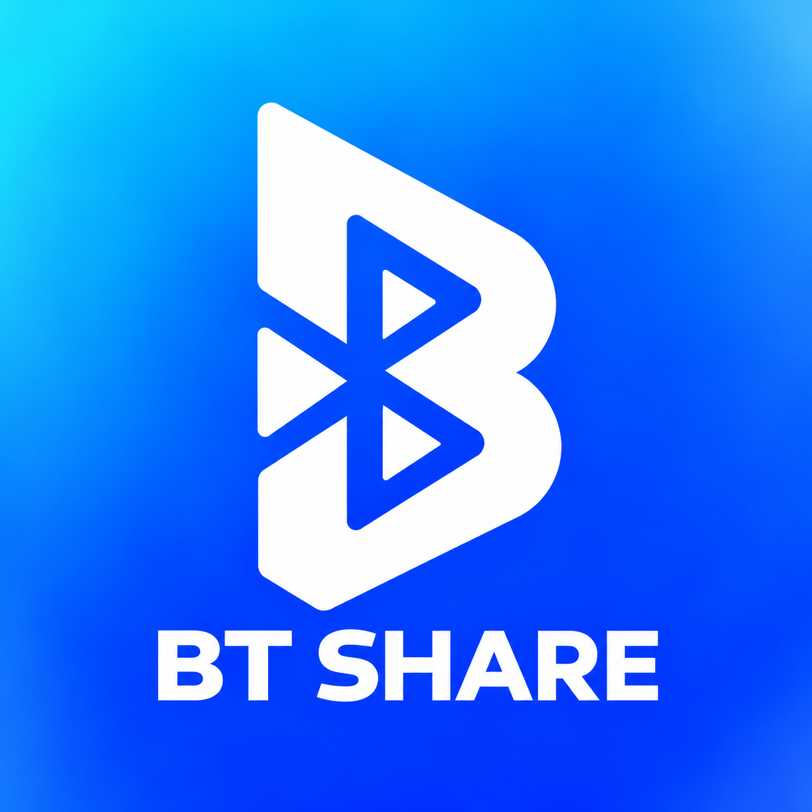
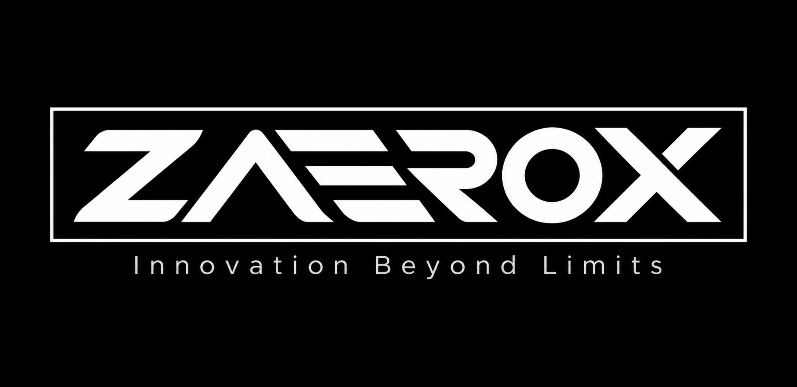
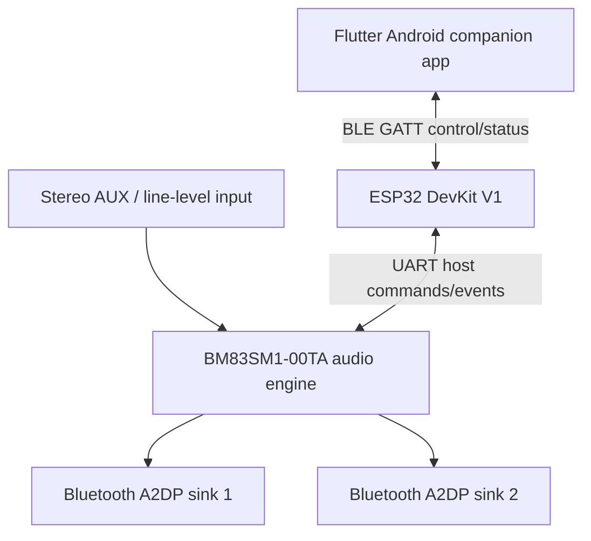

# BT SHARE

### Making shared wireless listening more accessible.

**Bluetooth audio sharing · Embedded hardware · Flutter companion app · Audio utilities**

**A ZAEROX product · Founded by X10 THINK**

[Project status](PROJECT_STATUS.md) · [Requirements](REQUIREMENTS.md) · [Decisions](DECISIONS.md) · [Development workflow](PROJECT_WORKFLOW.md) · [Website specifications](BT_SHARE_Website_Documentation/WEBSITE_REQUIREMENTS.md)

---

## Meet BT SHARE

**BT SHARE** is a product initiative founded by **X10 THINK** under its technology brand **ZAEROX**. The vision is to make shared wireless listening more accessible: one audio source, multiple compatible personal listening devices.

The project includes **two distinct hardware tracks** and two software workstreams. The first, educational prototype is a limited two-listener experiment; the broader, affordable commercial product remains in architecture and feasibility research. Neither the documented features nor the branding imply that a physical product is already available for sale.

| Workstream | Purpose | Repository-evidenced status |
|:--|:--|:--|
| **College hardware prototype** | USB-5V-powered AUX-input transmitter targeting two ordinary Bluetooth Classic A2DP sinks | Historical BRD/planning documented; latest native build and bench evidence **not present in this repository** |
| **Commercial product R&D** | Affordable multi-listener sharing; investigate **AUX or Bluetooth input** and independently verify 2, 3, 4+ receivers | Product direction under research; architecture and limits **not validated** |
| **Flutter Android app** | Control the BT SHARE hub over BLE and provide standalone sound utilities | **14 Flutter planning documents** plus feature scope are present; no executable app source/build results included |
| **Angular website & admin** | Product information, documentation, secure APK downloads, content and release administration | Planning documents available; no website/backend source, deployment or security-test evidence included |

> **Evidence first:** A proposed feature is not an implemented capability. Hardware gates, build results, cost figures, app releases and user-facing claims require verifiable supporting records. See [PROJECT_STATUS.md](PROJECT_STATUS.md).

## The company, the brand, the product

  

| Identity | Role |
|:--|:--|
| **X10 THINK** | Founding company behind ZAEROX and BT SHARE |
| **ZAEROX** | Technology brand · *Innovation Beyond Limits* |
| **BT SHARE** | Bluetooth audio-sharing product and related software ecosystem |

Brand identity, approved assets and usage guidance: [BRAND_IDENTITY.md](BRAND_IDENTITY.md). This relationship describes the team-provided brand structure; it does not imply trademark registration or third-party certification.

## How the first prototype is intended to work

The college prototype is **AUX-input only** and is being developed as a **USB-5V-powered** hardware proof of concept. The following diagram expresses the planned separation of audio and control; it does **not** claim that simultaneous playback has already been bench-proven.

- **Audio path:** external stereo AUX → BM83-based audio subsystem → intended A2DP receivers. The ability to deliver two active audio streams with the exact firmware/configuration still requires proof.
- **Control path:** Flutter → BLE GATT → ESP32 → UART → BM83. ESP32 owns the device/connection state exposed to Flutter.
- **Hardware-first acceptance:** verify electrical safety and BM83 bring-up, then one-receiver audio and simultaneous two-receiver audio **before requiring Flutter**.
- **Scope correction:** the later engineering direction for this specific prototype is **fixed USB 5 V, no battery/charger/UPS**; original 2026-10-06 documents are retained as historical baseline material. The actual current schematic and procurement evidence must be separately reconciled.

The **commercial product** is a separate R&D track. It aims to investigate accepting either a normal AUX signal **or** a compatible phone/computer Bluetooth audio source, then sharing audio with multiple ordinary earbuds/headphones across brands. Neither the Bluetooth-input path nor more-than-two listening devices is asserted as demonstrated.

## Mobile app — Android first

Planned in **Flutter + Dart** with two clear user experiences:

1. **Hub control:** discover and manage receiver connections through a versioned BLE interface with the ESP32; report actual device state and errors.
2. **Standalone sound workspace:** useful audio utilities even if the user does not own BT SHARE hardware. Planning covers equalizers, audio routing/mixing, volume controls, measurement tools, tuners/metronomes, ambient/focus sounds and hearing-related tools, subject to Android limitations and safety review.

The app planning catalogue also tracks additional concepts, recovery workflows and future tools. Their inclusion in planning is **not** a guarantee of availability, Android OS permission access or a first-release commitment.

**Architecture note:** [Flutter TRD](BT_SHARE_Flutter_Documentation/03_TRD_Technical_Requirements.md), [SDD](BT_SHARE_Flutter_Documentation/04_SDD_Software_Design.md) and [ADR-005](BT_SHARE_Flutter_Documentation/11_ADR_Architecture_Decision_Records.md) explicitly **propose feature-first Clean Architecture, MVVM-style presentation and Riverpod**. **DDD principles** are a compatible additional recommendation in the [architecture proposal](FeaturE_Scope_Documentations/mobile-app/ARCHITECTURE_PROPOSAL.md), not an existing approved decision. Formal architecture sign-off remains pending.

## Website and APK releases

The website workstream plans an **Angular** public experience with a product catalogue, documentation portal, verified APK release centre, and a separately authenticated admin area. The backend/hosting/storage providers are **not yet selected**. Production releases must have authenticated approvals, integrity checks, signing provenance and server-side authorization; no published APK is evidenced in the current repository.

[Website requirements](BT_SHARE_Website_Documentation/WEBSITE_REQUIREMENTS.md) · [Website architecture](BT_SHARE_Website_Documentation/WEBSITE_ARCHITECTURE.md) · [Feature catalogue](BT_SHARE_Website_Documentation/WEBSITE_FEATURE_CATALOGUE.md) · [Branding and content guidance](BT_SHARE_Website_Documentation/WEBSITE_BRANDING.md)

## Current development snapshot

| Item | Status |
|:--|:--|
| Original hardware BRD and execution plan | **Documented** (October 6 baseline) |
| Mobile feature scope and feasibility questions | **Documented** (October 14–15 scope) |
| Website and secure-admin requirements | **Documented** (October 27 drafts) |
| X10 THINK → ZAEROX → BT SHARE brand identity and artwork | **Provided by project owner** (October 29) |
| Native hardware design and electrical/audio acceptance gates | **Not verified from this repository** |
| Flutter and Angular executable source/build tests | **Not present in this supplied clone** |
| Feature-first Clean Architecture / MVVM / Riverpod | **Proposed in Flutter TRD/SDD/ADR-005; approval pending** |
| Public product availability and official APK release | **Not evidenced** |

See the maintained [project status and evidence register](PROJECT_STATUS.md). The original prototype budget ceiling of **LKR 40,000** is a historical project constraint, **not** a statement of current remaining funds or a purchase authorization.

## Documentation map

| Document | Why it matters |
|:--|:--|
| [Project status](PROJECT_STATUS.md) | Audited baseline, current unknowns and evidence gates |
| [Project workflow](PROJECT_WORKFLOW.md) | Roles, approvals, branch hygiene and verification rules |
| [Requirements index](REQUIREMENTS.md) | Tracks hardware, software and web scope separately |
| [Decision register](DECISIONS.md) | Approved choices vs. new proposals |
| [Brand identity](BRAND_IDENTITY.md) | Company/brand/product hierarchy and supplied assets |
| [Original hardware BRD](First_Documents/MD/BT_SHARE_BRD.md) / [PDF](First_Documents/PDF/BT_SHARE_BRD.pdf) | Historical educational prototype baseline |
| [Original execution plan](First_Documents/MD/BT_SHARE_Execution_Plan.md) / [PDF](First_Documents/PDF/BT_SHARE_Execution_Plan.pdf) | Original G0–G8 execution stages |
| [Flutter engineering docs](BT_SHARE_Flutter_Documentation/03_TRD_Technical_Requirements.md) / [Software design](BT_SHARE_Flutter_Documentation/04_SDD_Software_Design.md) / [ADRs](BT_SHARE_Flutter_Documentation/11_ADR_Architecture_Decision_Records.md) | Fourteen committed app specification files; technical approach proposed, not approved |
| [Mobile product scope](FeaturE_Scope_Documentations/mobile-app/PRODUCT_SCOPE.md) | Android first, hub-control and standalone sound tools |
| [Mobile feature catalogue](FeaturE_Scope_Documentations/mobile-app/FEATURE_CATALOGUE.md) | Planned app features and dependencies |
| [Mobile feasibility register](FeaturE_Scope_Documentations/mobile-app/FEASIBILITY_REGISTER.md) | What must be validated on real devices |
| [25-feature planning register](FeaturE_Scope_Documentations/mobile-app/FEATURE_EXPANSION_25.md) / [17-proposal register](FeaturE_Scope_Documentations/mobile-app/FEATURE_EXPANSION_17.md) | Expanded backlog, including future concepts |
| [Website requirements](BT_SHARE_Website_Documentation/WEBSITE_REQUIREMENTS.md) / [sitemap](BT_SHARE_Website_Documentation/WEBSITE_SITEMAP.md) | Public website, documentation, downloads and admin |

### Repository documentation integrity

The supplied **local clone at `bc5f287`** includes all fourteen files under [`BT_SHARE_Flutter_Documentation/`](BT_SHARE_Flutter_Documentation/03_TRD_Technical_Requirements.md) as **ordinary tracked files**, resolving the older gitlink issue seen in a previous commit. The documentation references previously pointing at renamed folders have been corrected in this prepared checkout. Run `python scripts/repair_repository_links.py --check` to recheck before publishing. Native Flutter application source, KiCad design files and tested releases are **not** part of this supplied clone.

## Contributing and engineering discipline

The project is developed in separate hardware/embedded, mobile, website and product workstreams. Keep PRs focused, cite requirements and evidence, review cross-team interface changes and never publish secrets, private signing keys or unauthorized manufacturer material.

**Especially important:** work already completed outside GitHub may exist, but it must be linked with an identifiable revision and evidence before the repository can mark it complete. Never make purchases, fabricate boards or claim successful playback based only on README wording.

---

**Created by X10 THINK · A ZAEROX product · BT SHARE**

*Innovation Beyond Limits*

